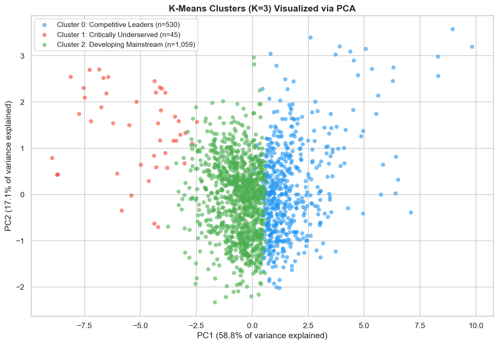
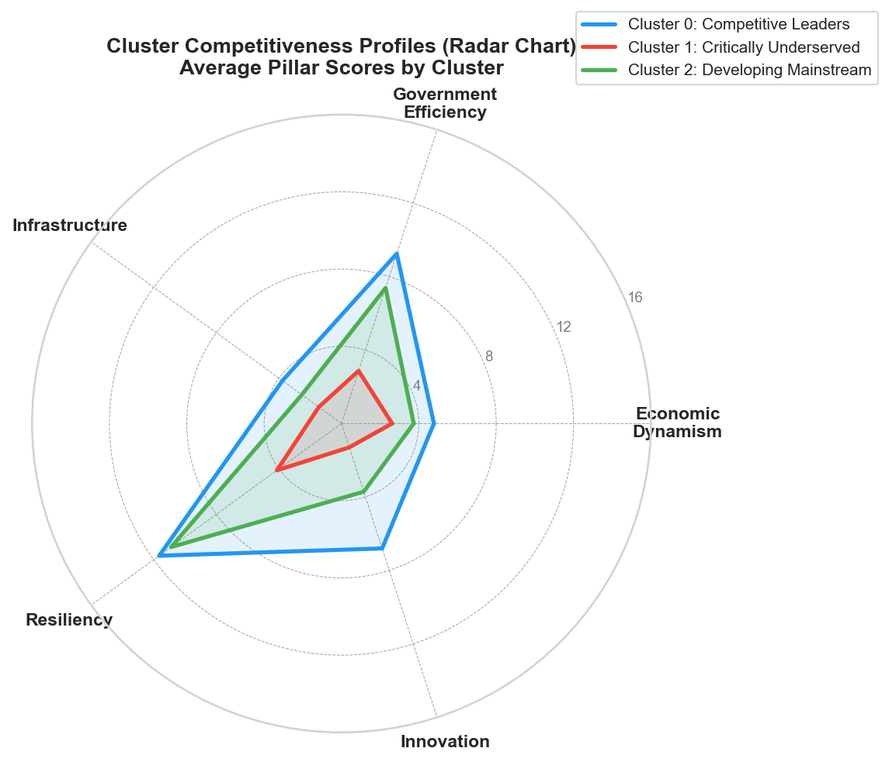
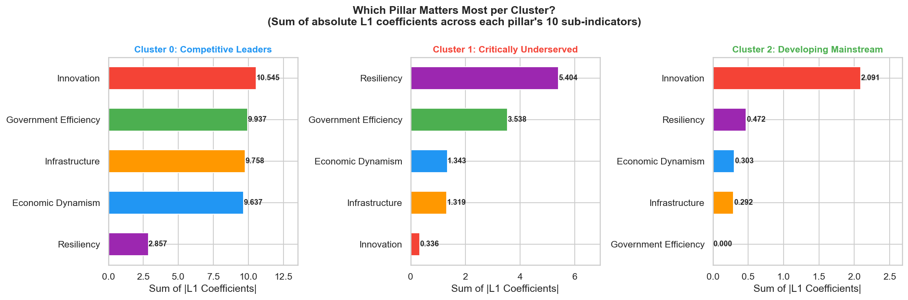

# Mapping the Competitiveness Divide: Clustering 1,634 Philippine Cities & Municipalities

Unsupervised clustering and sparse classification of the Philippine government's **Cities and Municipalities Competitiveness Index (CMCI) 2024**. The project finds natural competitiveness tiers among all 1,634 local government units (LGUs), identifies the specific sub-indicators that drive each tier, and produces a watchlist of the most at-risk municipalities.

📄 **[Read the paper (PDF)](report/report.pdf)** · 📓 **[View the notebook](cmci_lgu_analysis.ipynb)**

<p align="center">
  
  
</p>

## Results at a glance

| | |
|---|---|
| **3 tiers** | K-Means (K=3, selected by both the elbow and silhouette criteria, silhouette = 0.304): **Competitive Leaders** (530, 32.4%), **Developing Mainstream** (1,059, 64.8%), **Critically Underserved** (45, 2.8%) |
| **97.9%** | Test accuracy of an L1-penalized logistic regression that predicts the tier from the 50 raw sub-indicators alone (99.3% on the full dataset) |
| **Ceiling vs. floor** | Innovation carries the most weight for the Leaders tier. Resiliency deficits (no land-use plan, disaster drills, or risk assessments) most strongly mark the Underserved tier. |
| **Watchlist** | The 15 highest-risk LGUs are all in Sulu, Lanao del Sur, and Basilan (BARMM), each with a predicted probability of 1.0 |

<p align="center">
  
</p>

## Approach

1. **Data collection.** Scraped the five CMCI ranking tables (one per LGU class) from [cmci.dti.gov.ph](https://cmci.dti.gov.ph) with `pandas.read_html`, plus 50 sub-indicator tables.
2. **Exploratory analysis.** Examined pillar distributions, differences by LGU class, and correlations.
3. **Clustering.** Standardized the 5 pillar scores, ran K-Means for K = 2–10, and chose K using the elbow and silhouette methods. PCA was used for 2-D visualization.
4. **Explaining the tiers.** Trained a multinomial `LogisticRegressionCV` with an L1 penalty (SAGA solver, balanced class weights, stratified 80/20 split). This produced a sparse set of sub-indicators that separate the tiers.
5. **Watchlist.** Scored every LGU's probability of belonging to the Critically Underserved tier.

## Repository structure

```
├── cmci_lgu_analysis.ipynb     # Full analysis, end to end
├── data/
│   ├── cmci_2024_all.csv       # Raw rankings scraped from DTI
│   ├── pillars_data/           # 50 sub-indicator tables (+ pillar summaries)
│   └── cmci_2024_*.csv         # Intermediate outputs (clustered, indicators, master, final)
├── figures/                    # Charts used in the paper
└── report/
    ├── report.tex              # IEEE-format paper (LaTeX source)
    └── report.pdf
```

## Run it yourself

```bash
git clone https://github.com/tca-codes/philippine-lgu-competitiveness.git
cd philippine-lgu-competitiveness
python -m venv .venv && source .venv/bin/activate
pip install -r requirements.txt
jupyter notebook cmci_lgu_analysis.ipynb
```

To re-download the rankings from DTI, set `REFRESH_DATA = True` in the first data cell.

## Limitations

The CMCI is a single-year snapshot, so the analysis can't support causal claims. The classifier also predicts labels that K-Means created, so its accuracy shows internal consistency rather than validation against independent ground truth. Extending the analysis to multiple CMCI years would make it possible to track how LGUs move between tiers.

## Tools

Python · pandas · NumPy · scikit-learn · Matplotlib · Seaborn · Jupyter · LaTeX

---

*Final project for a Machine Learning course at Fordham University.* Built by **Tricci Angeles**.
Data: [DTI Cities and Municipalities Competitiveness Index](https://cmci.dti.gov.ph).
